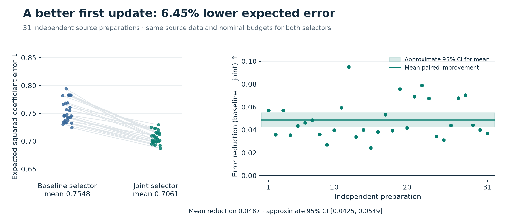
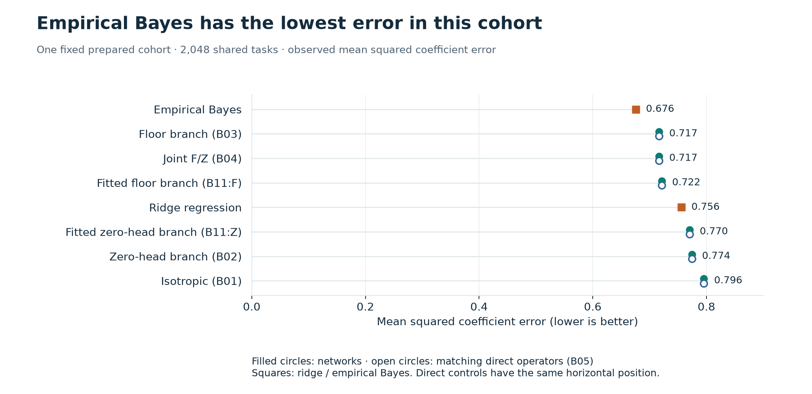
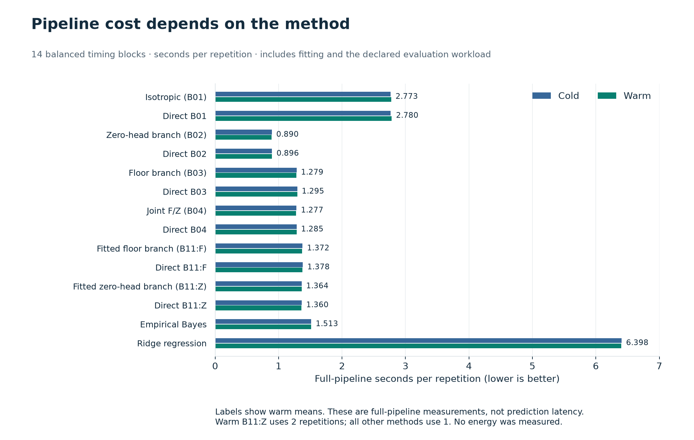

# Plasticity Frontier

**Prepare a network so its first gradient step learns more from a new task.**

A network can predict zero everywhere and still be ready to learn some directions
faster than others. This Python research code uses past tasks to choose those
directions and learning strengths, then builds the starting weights under limits
on initialization norm and trainable parameters.

[Results](docs/results/2026-11-03-source0b493b1-verdict.md) · [Reproduce](REPRODUCE.md) · [Math](docs/blueprint.md) · [Data](docs/results/release-v0.1.0/) · [Citation](CITATION.cff)

## What happened

**Expected error fell by 6.45% across 31 independent preparations:**
**0.7548 → 0.7061**. Each preparation learned from the same 128 training and 128
validation source tasks for both selectors. Both had a nominal squared-weight-norm
budget of 0.6 and a cap of 21 trainable parameters.



Each line joins one preparation's results; positive differences favor joint
selection. The approximate 95% Student interval for the **absolute improvement**
is **[0.0425, 0.0549]**. The percentage reduction is descriptive.

## How it works

1. **Learn what future tasks look like.** Estimate useful directions from source
   tasks, then fit and validate their learning strengths.
2. **Choose the update under both budgets.** Compare a branch that concentrates
   learning in selected directions with one that also gives every direction a
   common learning strength. This is the joint frontier.
3. **Build a zero-output network and update it once.** The starting weights encode
   that choice. Ordinary simultaneous gradient descent supplies the new task's
   information.

For the constructed network, that first update gives exactly the same coefficient
vector as the direct operator:

$$\widehat{\theta} = G\,\frac{X^\top y}{n}.$$

Here `G` is the prepared learning map; `X` and `y` are the new task's examples and
answers. The implementation uses step size 1 and loss `‖Xw − y‖² / (2n)`.
[The original note](docs/prepared_learning_research.pdf) and
[blueprint](docs/blueprint.md) give the assumptions and derivation.

## What the alternatives achieve

The primary result compares **two selection procedures**. The joint selector adds
the isotropic-floor family to the baseline's isotropic and zero-head choices;
both include fitted-gain variants.

A separate comparison fixes one prepared cohort and evaluates all 14 methods on
**2,048 shared test tasks**:



**Empirical Bayes gets lower error here.** All six direct operators reproduce
their network's task losses. The construction establishes how to realize the
learning map, with no special advantage from its network representation.

## What it costs

Times cover the full pipeline, including fitting, adaptation and evaluation,
on one ARM64 Mac. They aren't per-prediction latency.



The completed study covers small Gaussian linear-regression tasks and one update.
Nonlinear networks, real-world transfer and energy savings remain untested. The
norm cap uses the executed numerical tolerance; the [full verdict](docs/results/2026-11-03-source0b493b1-verdict.md)
records the floating-point qualifications and inconclusive diagnostics.

## Check it yourself

From a clone, with Python 3.12 or newer:

```sh
python3 scripts/verify_public_results.py
```

This checks the public data and recomputes the headline means. To explore the code:

```sh
python3 -m venv .venv
.venv/bin/python -m pip install -e .
.venv/bin/python -m prepared_learning check-theory --config configs/exploration/exact_cases.json
```

The recorded full clean replay matched on the original machine. This release
includes its receipt, compact loss data and figure rebuild scripts; large raw
stores and replay execution packages remain local. [Setup, tests and replay boundaries](REPRODUCE.md).

By **Artem Legotin**. **AGPL-3.0-only** software; **CC BY 4.0** original writing,
figures and result compilations. [Licensing](LICENSING.md) · [Attribution](THIRD_PARTY_NOTICES.md).
Cite [CITATION.cff](CITATION.cff) and record the commit used. Development and reporting
used AI assistance; README editing used [write-like-me](https://github.com/arlegotin/write-like-me).
