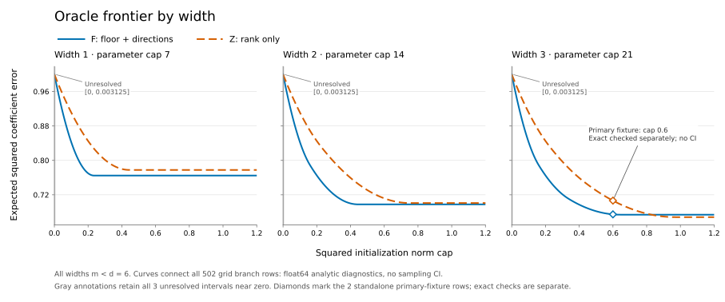

# Local research verdict — 1 November 2026

The exact mathematical example works. Learning a reliably tuned initializer from data remains unconfirmed. This campaign stopped before protected confirmation at its declared tuning gate.

The idea is to arrange a network's starting weights so its first update learns more useful directions. Different arrangements can all predict zero initially. The comparison fixes network size, initialization norm, learning rate and information access.

In the checked example, F has expected squared coefficient error **0.6745872556**, versus **0.7064956522** for Z: approximately **4.5% less error**, before adding observation noise to prediction loss. Both use squared initialization norm cap 0.6 and 21 trainable parameters, including initialized zeros. This is a finite oracle-prior result for a deep linear model, with exact rational KKT certificates. It is not a learned-prior or general neural-network performance result.

A compact direct calculation reproduces the canonical network's first update. Practical value therefore also depends on preparation, storage, integration and later behavior; this study establishes no advantage over that identical estimator.



The [complete frontier CSV](../../reports/2026-11-01-local/frontier.csv) retains both branches, all 251 grid points and three unresolved near-zero intervals. The numerical curves and the two exact certificates have different verification levels.

More source data improved the estimated task patterns in the exploratory cohort:

| Training tasks / validation tasks | Independent preparations | Mean relative covariance error | Upper diagnostic |
|---|---:|---:|---:|
| 32 / 32 | 6 | 0.701 | 0.798 |
| 128 / 128 | 6 | 0.484 | 0.559 |
| 256 / 256 | 6 | 0.358 | 0.397 |

The upper diagnostic is mean + 1.96 standard errors, not a rigorous population bound. These measurements describe prior estimation, not the full procedure's prediction benefit. The cap5 and cap8 executions reused the **same 18 preparations**; the repeat added no independent observations. See [source data](../../reports/2026-11-01-local/source_curve.csv).

One B04 candidate group remained unresolved after finer tuning. Its estimated rank-three moment prior changes only slightly between shrinkage 0 and 1/256, but the estimated-risk optimizer switches from Z to F. Held-out source query MSE changes from **1.8724447 to 1.7622426**. Within F the change is only 0.00008894, and within Z it is zero. The cross-branch gap, 0.1102021, exceeds the declared objective-resolution tolerance, 0.0703255.

The trace preserves the same ordered basis and correct completed branch solutions. This is a genuine solution switch under the current procedure. It is not a population comparison or evidence that the final learned selector loses. The [diagnosis](../../reports/2026-11-01-local/source-branch-switch-diagnosis.md) and [retained-row evidence](../../reports/2026-11-01-local/source-branch-switch-diagnosis.json) document the distinction.

The gate stopped the expensive descendants. The full pilot with at least 30 preparations per block, protected comparison, retained transfers, and finalized 14-method operational panel were **not run**. There is no final primary sample count, protected cohort, confidence interval or learned effect estimate. A future branch-aware tuning protocol must be declared before a fresh study.

The completed local work includes:

- The supplied source simulation with its 200,000-task schedule, exact arithmetic checks and adversarial geometry checks.
- All 26 small descriptive robustness arms, retaining precision loss, injected failures and outside-class controls. Their amendments and transfers remain unperformed.
- A four-control, 16-worker exploratory cost probe with passing equality checks and resolved tuning. It is not a finalized operational comparison. Its engineering forecast concerns this implementation's conservative admission policy, not an inherent RAM requirement of the mathematical idea.
- A clean clone and fresh locked environment: seven mathematical/descriptive executions matched, including exact F/Z checks with zero tolerance. All 144 report-inventory files and 81,560 archived original files were preserved.
- **304 tests passed** on the executed source revision. The original blueprint, PDF, ZIP, source manifest and dependency lock hashes remain unchanged.

Historical full-matrix optimizer failures remain visible: four of six in supplied records and five of six in the earlier developer diagnostic. Those failures do not become certificates or counterexamples. The automatic adverse-status index is narrower than the full evidence; the complete diagnostics and archives retain the other adverse outcomes.

All scientific execution above used **`536a4003ca402d2e67d51b3bf24da256c3829314`**. This evidence is committed afterward. [The machine-readable summary](../../protocol/campaign-2026-11-01-summary.json), [claim ledger](../../reports/2026-11-01-local/claim_ledger.csv), [ordered manifest](../../protocol/campaign-2026-11-01-report-inputs.json) and [replay receipt](../../protocol/campaign-2026-11-01-replay.json) preserve that boundary. G10 supports report reconstruction and replay in the executed scope; it does not promote the unperformed studies.

With the retained local raw assets, source history, Python installation and locked wheels, replay through the public interface:

```sh
.venv/bin/python -m prepared_learning replay \
  --manifest protocol/campaign-2026-11-01-report-inputs.json \
  --output runs/replay-2026-11-01-review
```

Use a fresh output directory. The large automatic report, original figures, all command captures and complete source archives remain in `runs/campaign/2026-11-01-main-objective-v1/`. The tracked evidence directory contains the concise view and selected raw outputs.
